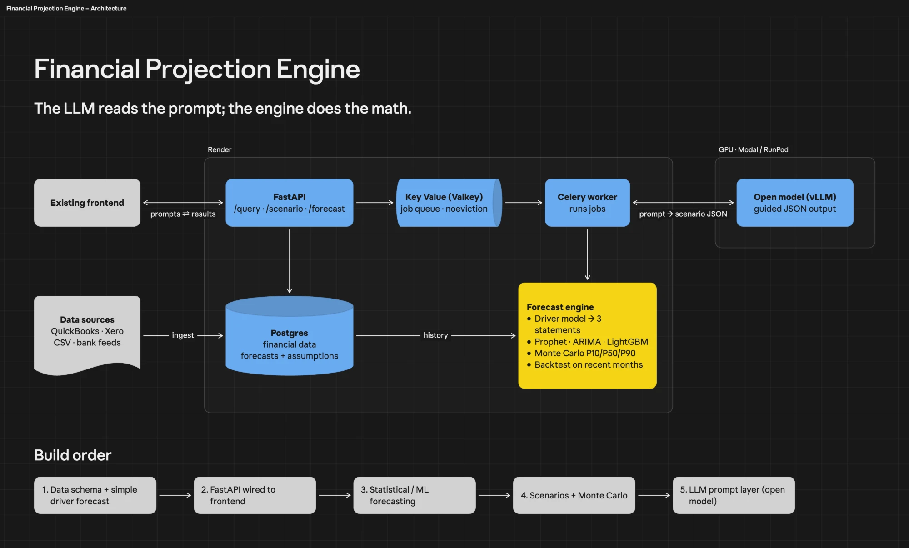

# Architecture

**The LLM reads the prompt; the engine does the math.**

## Components (target)

| Component | Where | Role |
|---|---|---|
| Existing frontend | outside | Sends prompts, shows results |
| FastAPI (`/query`, `/scenario`, `/forecast`) | Render | Public API |
| Key Value (Valkey) | Render | Celery job queue (`noeviction`, so queued jobs are never dropped) |
| Celery worker | Render | Runs forecast jobs and calls the model |
| Postgres | Render | Financial data, saved forecasts and their assumptions |
| Forecast engine | Render (in the worker) | Driver model producing 3 statements; Prophet / ARIMA / LightGBM; Monte Carlo P10/P50/P90; backtest on recent months |
| Open model (vLLM) | GPU on Modal / RunPod | Turns a prompt into scenario JSON using guided JSON output |
| Data sources | outside | QuickBooks, Xero, CSV and bank feeds, ingested into Postgres |

## Build order

1. Data schema + simple driver forecast — **done**
2. FastAPI wired to frontend — **done** (API built; frontend wiring pending)
3. Statistical / ML forecasting — **done** (seasonality, ETS, ARIMA, Prophet, backtest selection; LightGBM deferred, see below)
4. Scenarios + Monte Carlo
5. LLM prompt layer (open model)

## Where the code stands vs. the plan (after step 3)

**In place:** FastAPI, Postgres (tenants, actuals, saved forecasts with assumptions),
CSV ingest, API-key auth, per-tenant query scoping, Render blueprint. Forecast
engine: seasonality detection, driver / seasonal naive / ETS / ARIMA / Prophet
models per line, rolling-origin backtest with model selection, and the latest
backtest window returned for charting.

**Gaps to close:**

- **Endpoint names.** The diagram has `/query`, `/scenario` and `/forecast`. The code
  has `/tenants/{id}/forecasts`, and scenarios are driver overrides on the forecast
  request. Settle on one shape before the frontend is built against it. `/query` is
  the LLM prompt endpoint and belongs to step 5.
- **No job queue yet.** Forecasts still run during the request. Measured after
  step 3: an `auto` forecast (5 models x 3 backtest origins x 2 lines) takes
  about 1.5-2.5 s on a dev machine, so expect several seconds on a Render
  starter instance. That is slow but workable. Monte Carlo (step 4) multiplies
  the work, so the Valkey + Celery queue should land with it, changing the API
  once: start a job, then poll for its result. Scenario runs with overrides
  skip the backtest for the overridden lines and stay fast.
- **LightGBM not included.** Gradient boosting needs far more points than one
  company's 24-60 monthly values. It would lose to ETS/driver in the backtest
  and add a dependency. Worth revisiting with daily or weekly data, or pooled
  training across tenants.
- **One statement, not three.** The engine produces an income statement only
  (revenue → operating income → net income). The balance sheet and cash flow need
  extra drivers (payment timing, capex, debt) and likely more categories than the
  current four (`revenue`, `cogs`, `opex`, `other`).
- **CSV only.** QuickBooks, Xero and bank feeds should each be a connector that
  outputs the same `LineItem` format, so the engine and API don't change.
- **LLM layer.** Stays separate until step 5. `DriverOverrides` (from step 1) is
  already the "scenario JSON" the model will fill in.
